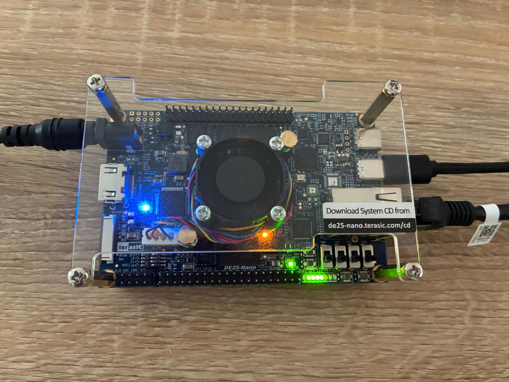

# Projeto DE25-Nano

<p align="center">
 
</p>


Código FPGA, software Linux e documentação para a Terasic DE25-Nano.

O primeiro acesso SSH por USB foi validado. A aplicação do projeto ainda será definida.

## Estrutura

- `docs/`: configuração e documentação da placa.
- `fpga/rtl/`: fontes HDL.
- `fpga/constraints/`: pinos e restrições de tempo.
- `fpga/sim/`: testbenches e simulação.
- `fpga/quartus/`: projeto Quartus e configurações reproduzíveis.
- `software/`: programas para o Linux da placa.
- `scripts/`: automação de compilação e transferência.

## Acesso à placa

Consulte o [guia SSH por USB](docs/GUIA_SSH_USB_DE25_NANO.md).

Com a rede USB configurada, conecte a porta HPS USB ao computador e execute:

```bash
ssh terasic@192.168.7.2
```

A configuração USB documentada ainda é temporária.

## Ambiente validado

- Placa: Terasic DE25-Nano.
- Kernel Linux da placa: `6.12.11-gd7d192a9ddd9`.
- Computador de desenvolvimento: Linux.
- Versão do Quartus e imagem Linux utilizada: a registrar.

## Organização do desenvolvimento

Versionar fontes, testes, scripts, configurações e documentação. Manter caches e
resultados de compilação fora do histórico. Registrar instruções de compilação e
execução junto com cada aplicação adicionada.
