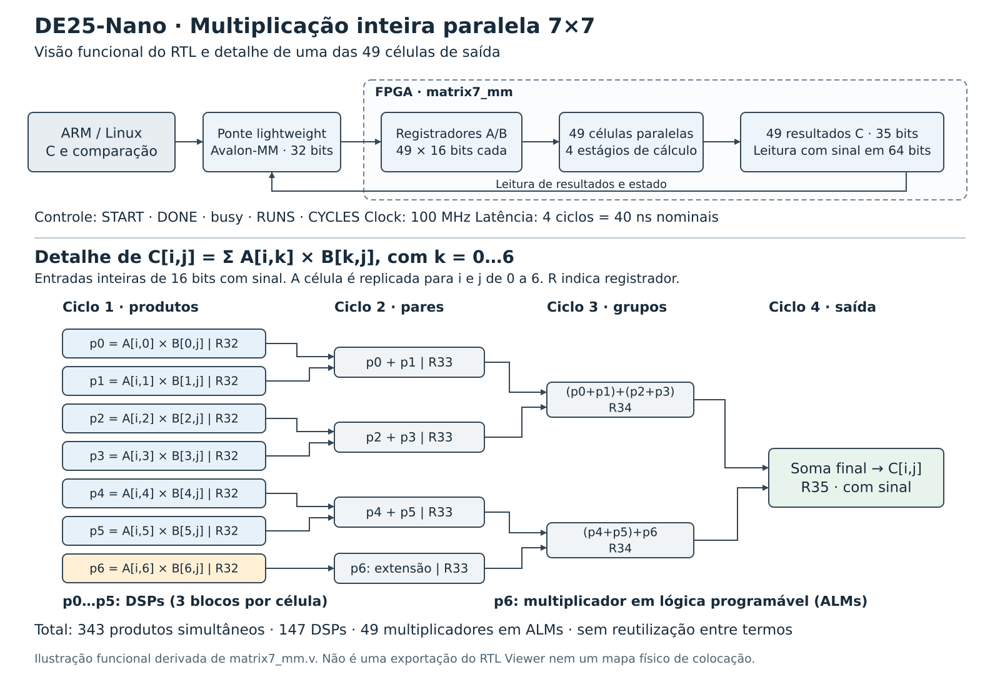

# Esquemas do multiplicador 7×7 para ilustração e impressão

Há duas representações úteis: o esquema gerado pelo Quartus a partir do projeto
e uma ilustração funcional simplificada, preparada para leitura em papel.

## Figura pronta para o relatório

- [SVG vetorial, recomendado para impressão](../img/matrix7x7/esquema_funcional_7x7.svg).
- [PNG de alta resolução](../img/matrix7x7/esquema_funcional_7x7.png).



A figura foi desenhada a partir de `rtl/matrix7_mm.v` e dos recursos confirmados
pelo Fitter. Mostra a interface ARM/FPGA e uma célula `C[i,j]` com os sete
produtos, os registradores e os três níveis de somas. A célula é replicada
49 vezes: 294 produtos em 147 DSPs e 49 produtos em ALMs.

**É uma ilustração funcional, não uma exportação do RTL Viewer nem uma planta
de colocação física.** O Quartus pode agrupar, otimizar e retimar recursos;
as caixas do desenho representam os estágios conceituais descritos no RTL.

Para imprimir o SVG, abra-o no navegador e use imprimir, papel A4, orientação
paisagem e ajuste à área imprimível. SVG mantém texto e traços vetoriais ao
redimensionar. PNG é útil para inserir em programas que não aceitam SVG.

O desenho pode ser recriado na raiz do repositório:

```bash
python scripts/gerar_esquema_matrix7x7.py
```

Esse comando gera o SVG e usa apenas a biblioteca padrão do Python. Para
recriar também o PNG, com ImageMagick disponível:

```bash
convert -background white -density 192 \
  img/matrix7x7/esquema_funcional_7x7.svg \
  -resize 3200x2200 img/matrix7x7/esquema_funcional_7x7.png
```

## Gerar o esquema no próprio Quartus

### 1. Escolher o projeto

Para estudar o multiplicador sem a complexidade do HPS e da memória, abra:

```text
fpga/MatrixMultiplication7x7/quartus/MatrixMultiplication7x7.qpf
```

Para ver o circuito integrado ao sistema, abra a cópia compilada do GHRD:

```text
fpga/MatrixMultiplication7x7/build/ghrd_7x7/golden_top.qpf
```

O projeto isolado é para visualização/síntese, não para programar a placa.
Para a ilustração de aritmética, ele produz uma vista mais focada.

### 2. Abrir a representação RTL

Execute Design Analysis ou Analysis & Elaboration se necessário. Nas versões
Pro recentes, o Compilation Dashboard oferece **RTL Analyzer** no estágio de
análise/elaboração. Ele permite percorrer a hierarquia e suas conexões.

O **RTL Viewer**, quando disponível no menu Tools → Netlist Viewers, apresenta
a representação esquemática RTL. Os nomes e ferramentas disponíveis variam
entre edições e versões; o RTL Analyzer das versões Pro recentes não deve ser
confundido com uma vista física dos DSPs.

No projeto isolado, o topo é `matrix7_mm`. No GHRD, localize `matrix7_0` sob
`soc_inst/subsys_periph`; a interface pode apresentar separadores diferentes.

### 3. Escolher um recorte legível

O circuito completo possui 343 multiplicadores, 49 saídas e controle. Uma
única figura com todos os fios pode ficar ilegível em A4. Para relatório,
prefira uma vista geral e outra detalhando apenas uma saída.

Use as funções de busca/filtro do visualizador para selecionar os sinais de
uma célula, por exemplo os nomes com prefixo `rows[0].cols[0]`, ou os
registradores que alimentam `c[0]`. Os nomes podem mudar após otimização.
Mostre as larguras dos barramentos e os registradores que separam os estágios.

### 4. Mostrar os DSPs reais

Depois da síntese, abra o **Technology Map Viewer** na opção pós-mapeamento
disponível no menu de Netlist Viewers. Essa vista mostra primitivas e a
implementação tecnológica, em vez de somente operações do RTL.

Para recursos finais do sistema completo, consulte os relatórios pós-Fitter:
eles confirmaram 147 DSPs. O número de caixas desenhadas numa vista filtrada
não substitui a contagem do relatório físico.

### 5. Exportar ou imprimir

Com a janela do esquema ativa, use **File → Export** quando disponível.
Nos Netlist Viewers clássicos, a documentação lista PNG, JPEG, GIF e BMP.
Prefira PNG para linhas/texto, em vez de JPEG. Se o diálogo permitir escolher
dimensões, aumente-as para preservar a leitura dos rótulos na impressão.

Para impressão, o visualizador também pode oferecer **File → Print**.
Se houver destino “Imprimir para arquivo/PDF” no sistema, ele permite guardar
uma versão para impressão; confira a legibilidade e a divisão em páginas no
resultado. Não se deve presumir que o Quartus exporte SVG nativamente.

Esses caminhos são orientações baseadas na documentação. A exportação nativa
da janela Quartus não foi automatizada nesta etapa; os SVG/PNG fornecidos
acima são a ilustração funcional explicitamente identificada como tal.

## Referências

- [RTL Analyzer no Quartus Prime Pro](https://docs.altera.com/r/docs/683236/25.3/quartus-prime-pro-edition-user-guide/analyzing-design-rtl).
- [RTL Viewer: visão esquemática](https://docs.altera.com/r/docs/683230/18.1/quartus-prime-standard-edition-user-guide-design-optimization/rtl-viewer-overview).
- [Export Dialog Box — formatos dos Netlist Viewers](https://resources.altera.com/quartushelp/19.4/global/global/gl_com_export.htm).
